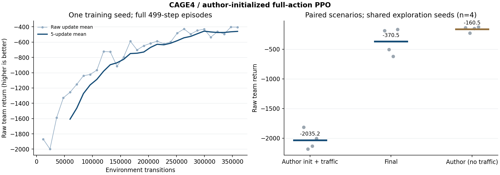
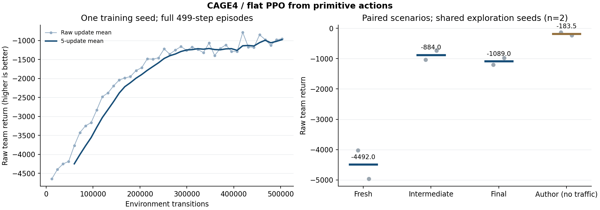

# CAGE4 实测结果（2026-10-23）

已完成关键环境/训练接口修复，建立可继续研究的含流量控制平坦PPO基线。实际学习与后期经验平台均有证据；不把它称为论文性能复现或数学收敛。

## 学习与平台

| 初始化 | 本次训练 | 同场景起点 | 末尾模型 | 说明 |
|---|---:|---:|---:|---|
| 完全随机 | 42轮 / 502,992环境步 | −4492.0 | −1089.0 | 两个场景；证明端到端学习，不靠固定子策略 |
| 公开作者权重 | 30轮 / 359,280环境步 | −2035.25 | −370.5 | 四个冻结场景；所有actor/critic继续优化 |
| 作者原动作子集参考 | 使用其公开预训练模型 | — | −160.5 | 同四场景；保留其不使用流量控制的原动作子集 |

原始团队回报越高越好。作者已有预训练能力不计为本次训练收益；两种初始化分别画曲线，没有拼接。强基线最后两组各5轮训练均值为 **−456.64 / −459.71**，相差约0.7%；后10轮均值 **−458.175**。继续改善已消失，30轮结束后停止，未继续盲目延长。

## 冻结模型逐场景结果

每个回合499真实transition，环境/奖励/攻击者不改；探索随机数每回合重置为scenario+710000，排除模型加载消耗随机数的影响。

| 场景seed | 作者初始化后开放控制的起点 | 本次30轮末尾 | 作者原动作子集参考 |
|---|---:|---:|---:|
| 54001 | −1815 | −188 | −138 |
| 54002 | −2184 | −505 | −229 |
| 54003 | −2135 | −621 | −149 |
| 54004 | −2007 | −168 | −126 |

四个场景均改善；54003/54004在模型冻结后补充检查。它们不是多个独立训练seed，不用于声称大范围泛化。与作者强参考仍有差距，尤其本次模型仍偶尔选择Block并产生业务代价；不要把当前结果包装为已追平原论文。

最终评估通过真实 `Policy.from_checkpoint` 恢复全部五个Policy完成任务，非只复制参数。官方reward分解逐步累计，严格加总为展示回报；例如54001末尾任务reward−112、Restore动作代价−76，合计−188。Sleep均来自多步动作等待mask；自主动作仍包含Analyse/Decoy/Remove/Restore及少量流量控制，没有塌缩成空动作。

## 修复与运行位置

- mask与实际动作/主机槽对齐，不原地改写官方mask、不放开Invalid/Padding。
- 多步动作保留已有特征供critic使用，只允许Sleep等待。
- Remove不再被错误解释为清除文件/特权感染；成功Restore后才重置IOC。
- 有限任务终点统一terminated，不bootstrap；团队reward不重复计五份。
- CAGE4独立runtime与venv，不再依赖CAGE3目录；CAGE3训练没有恢复。
- 两个上游tracked源码保持不变，修复单独实现，所有协议变化和失败记录保留。

远端选定模型：
`/Users/tiankedi/cage4-research/runs/flat-full-actions-author-init-s321/final`

看板：`http://127.0.0.1:8501`（既有SSH转发）。

服务器模型备份：`deliverables/cage4-baseline-20261023.tgz`（Git中不含权重）。使用方法见docs/BASELINE_PROTOCOL_zh.md，源代码/配置/依赖路径/空间布局/逐场景原始结果一并保存。采用作者state-derived观测协议，不冒称纯Blue observation版；详见AUDIT.md。
